# Implementing a codec for a custom type
Instead of implementing optimized read and write methods for every combination of reading/writing function, I/O subtype, encoding scheme, and type,
BitScribbling.jl abstracts this by asking you to implement one "codec" for each type/encoding scheme pair.
Since most types only have a single encoding scheme, this usually means a single codec implementation per type to get a broad variety
of encode, decode, load and store methods.

## Encodings and codecs
A type may be written in several different ways. For example, `0xa53b` may be written (in binary):
* `3b a5` in little-endian binary
* `a5 3b` in big-endian binary
* `34 32 32 39 39` in ASCII decimal
... and so on.

This is modelled as zero-sized [`Encoding`](@ref) subtypes.
Users may define arbitrary `Encoding`s and implement codecs for them.

This API consists of three mandatory methods.
See their docstrings for details (click them to go to their docstring in this documentation).
* [`BitScribbling.codec_max_encoded_size`](@ref) gives the maximal size in bytes for the encoding of any instance of a type, as a `Val`.
* [`BitScribbling.codec_try_decode`](@ref) attempts to decode an instance of `T` from a [`BitScribbling.DecodeInput`](@ref).
* [`BitScribbling.codec_try_encode!`](@ref) attempts to encode an instance of `T` into an [`BitScribbling.EncodeOutput`](@ref).

`codec_try_decode` reads its input through [`BitScribbling.require_bytes`](@ref), [`BitScribbling.peek_byte`](@ref) and [`BitScribbling.decode_field`](@ref), and `codec_try_encode!` writes its output through [`BitScribbling.reserve_bytes`](@ref) and [`BitScribbling.encode_field`](@ref). When loading from an `AbstractBufReader`, these make the reader wait for exactly the bytes the codec reads, so a codec for a variable-length encoding, like `Char`'s `UTF8` encoding, doesn't make loading wait for the maximal number of bytes of any instance of `T`. A codec is compiled twice: for inputs and outputs known to hold the maximal number of bytes, where the checks of these functions are removed, and for shorter ones, near the end of the data.

## Deriving codecs automatically
Instead of implementing a codec, a type can get one from its [`CodecScheme`](@ref BitScribbling.CodecScheme), by adding a method to
[`BitScribbling.codec_scheme`](@ref BitScribbling.codec_scheme). It defaults to `Manual()`, which means the codec must be
implemented manually, as described above.

### Bits types
Two encodings are special: `LittleEndian` and `BigEndian` (together: [`Endianness`](@ref)) represent the "native" binary representation of an object.

Not all objects must have [`Endianness`](@ref) encodings. For example, the `BigEndian` encoding of the Julia `Char` `'Ø'`
would be `c3 98 00 00` (same as `reinterpret(UInt32, 'Ø')` in big endian), but it may not be prudent to expose the internal binary representation of Julia objects.
Instead, BitScribbling.jl defines a `struct UTF8 <: Encoding end`, and defines the encoding of `'Ø'`
under `UTF8` as `c3 98` (which is its representation in e.g. a Julia `String`).

For the endianness encodings, the codec may be derived from the bits of the type in memory:

* If `codec_scheme(T, e)` returns `BitsLoadable()`, the type may be loaded and stored via pointer loads or stores, or memcpy.
* Else, if it returns `BitsStorable()`, it may be stored via pointer stores, but needs validation on loading, as not all bit patterns are valid.

See more [details about the codec schemes on the Concepts page](@ref bitskinds).

This simplifies the common case for e.g. `UInt32` where the endianness encoding is simply writing its bits directly to memory (possibly byte-swapping, depending on the host CPU endianness).

### Proxies
A type that can be converted to and from another type `P` with a codec can be encoded exactly as `P` is,
with any encoding that `P` has a codec for, by declaring `codec_scheme` to be `Proxy{P}()`.
Then, implement [`BitScribbling.to_proxy`](@ref BitScribbling.to_proxy) and [`BitScribbling.try_from_proxy`](@ref BitScribbling.try_from_proxy).
The latter returns `nothing` if the proxy is not a valid value, which makes decoding fail with `InvalidData`.

For example, this struct has padding in memory, so it can't be `BitsLoadable`, but it can be encoded
as a tuple, which has no padding in its encoding:

```julia
using BitScribbling: BitScribbling, Proxy, Endianness

struct Record
    kind::UInt8
    id::UInt32
end

BitScribbling.codec_scheme(::Type{Record}, ::Endianness) = Proxy{Tuple{UInt8, UInt32}}()
BitScribbling.to_proxy(x::Record, ::Endianness) = (x.kind, x.id)
function BitScribbling.try_from_proxy(::Type{Record}, (kind, id)::Tuple{UInt8, UInt32}, ::Endianness)
    return Record(kind, id)
end
```

The encoding of a `Record` is then 5 bytes: the `kind`, followed by the `id`.
A proxy compiles to the same code as its proxy type does, except that the bulk functions,
such as [`decode_all!`](@ref), can't copy the memory of many values at once, as they can
for `BitsLoadable` types.

If no other way applies, the codec has to be manually implemented,
as described above. That is always a valid option for any type whose encodings have a
bounded size, also for types that are not bitstypes.

## Visual guide


### Structs
To be `BitsLoadable`, all fields of the struct must be `BitsLoadable`.
Similarly, to be `BitsStorable`, all fields must be `BitsStorable` or `BitsLoadable` (which implies `BitsStorable`).

#### Padding
Padding is not allowed in derived codecs, because they present pitfalls for users.
Because padding is platform-dependent, BitScribbling.jl uses a conservative algorithm for determining padding: It assumes the alignment of a primitive is equal to its size. A struct's alignment is the largest among its fields.

So, for example, this struct:

```julia
struct Foo
    a::UInt32
    b::Float16
end
```
cannot be `BitsLoadable` or `BitsStorable`, because it has `sizeof(Foo) == 8`, yet the sum of its field sizes is only 6. There are two bytes of padding at the end.

`Tuple`s are special-cased structs, and allow padding. Padding is ignored when encoding and decoding, i.e. the fields are written in order, without padding.

### Odd-sized primitives
As of Julia 1.14, Julia supports primitive types with a bit size not a multiple of 8, such as a 20-bit primitive type. These are known as odd-sized primitives (OSP).
Because such types are stored with padding, OSP cannot be `BitsLoadable` or `BitsStorable`. For background, see the [Concepts page](concepts.md).

Furthermore, the abstractions of BitScribbling.jl only have the concept of reading or writing an integer number of bytes.
There is no interface to read 20 bits (2 bytes and half of the next byte).

Therefore, any manual codec for OSP types must read an integer number of bytes, unpacking the bits by hand. This may be done by loading a wider type and casting to OSP, as in the example below. Note that in this case we still load an integer number of bytes, since 2 × 20 bits = 40 bits = 5 bytes.

```julia
using Core.Intrinsics: trunc_int
using BufferIO: AbstractBufReader, get_nonempty_buffer, consume
using BitScribbling: decode, LittleEndian

primitive type U20 20 end

function load_two_u20(io::AbstractBufReader)
    buffer = @something get_nonempty_buffer(io, 5) return nothing
    a = decode(buffer, 1, UInt32, LittleEndian())
    b = decode(buffer, 2, UInt32, LittleEndian())
    consume(io, 5)
    return (trunc_int(U20, a), trunc_int(U20, b >> 12))
end
```
